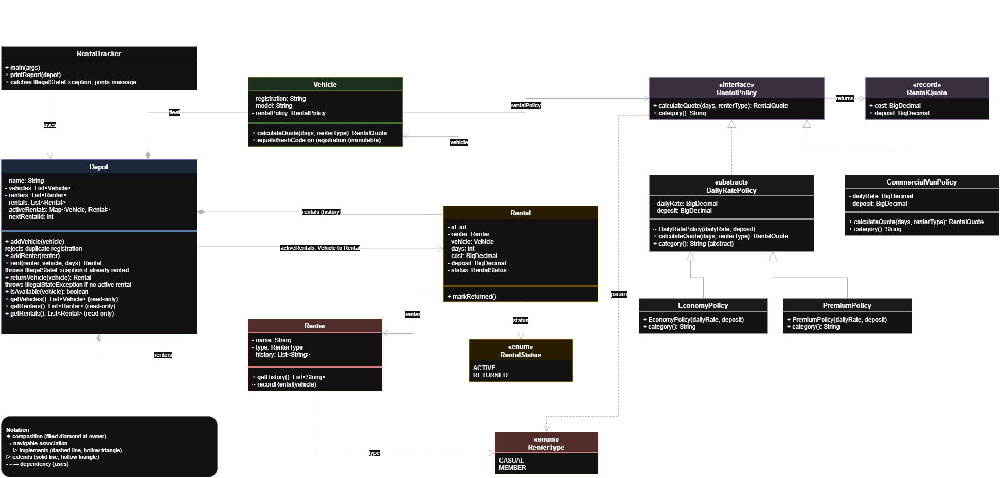

# Dovewing Car Rentals: Code Diagnosis

## 1. Purpose and Scope
This document diagnoses the risks in the original Dovewing Car Rentals implementation before the rebuild. 

The objective is to reorganise the application so that it is safe to maintain and extend while preserving its existing valid business behaviour. 

The one deliberate business-behaviour correction is that a vehicle must never have more than one active rental at a time. The application must also prevent its fleet availability and rental records from contradicting one another. 

The original program was run before any source-code changes. Its output is preserved in `ORIGINAL_OUTPUT.txt` and serves as the baseline for the rebuild.

---

## 2. Ranked Findings

### 1. The application allows contradictory vehicle and rental states
* **Severity:** Critical: business correctness and data integrity
* **Evidence:**
  The original output shows two active rentals for the same vehicle registration, `GT-1234-20`:
  * **Rental #1:** Kofi Mensah, 3 days.
  * **Rental #3:** Ama Owusu, 2 days.
  
  The fleet report shows the Vitz as `RENTED`, while the rental history contains two active rentals for it.
  
  There is a second problem in the return operation. `returnVehicle()` marks the supplied vehicle as available and closes every active rental with a matching registration. If the Vitz is returned after the two rentals above have been created, both rental records will be marked returned, even though the first customer may still have the vehicle.
  
  The application can therefore lose the evidence of an outstanding rental and report a vehicle as available when it is still with a customer.
  
  An additional inconsistency occurs when `rent()` receives an unsupported vehicle category: it can create an active rental without changing the vehicle's status from `AVAILABLE`.
* **Root cause:**
  The application has two independently maintained representations of whether a vehicle is rented:
  1. `Vehicle.status`
  2. The active rental records in the depot's rental collection.
  
  Nothing guarantees that these representations remain consistent. The rental operation also does not check availability before creating another rental, and the return operation does not identify one specific active rental.
* **Business risk:**
  A physical vehicle could be promised to multiple customers. A return could close multiple rental records incorrectly, and the fleet report could show a vehicle as available when it is still rented.
* **Proposed direction:**
  Make the depot the single owner of the active vehicle-to-rental relationship, using a private mapping:
  `Map<Vehicle, Rental> activeRentals`
  
  A vehicle is available when it is not a key in this mapping. If it is present, its associated rental is its current active rental.
  
  The depot must:
  * Check availability before creating a rental.
  * Reject a second active rental for the same vehicle.
  * Associate a vehicle with exactly one active rental.
  * Return only the specific active rental associated with that vehicle.
  * Remove the active mapping when the rental is returned.
  * Retain returned rentals in the historical rental collection.
  
  There will be no separately mutable vehicle status field. Availability will be derived from the depot's active rental mapping.

### 2. Important state and collections are publicly mutable
* **Severity:** Critical: data integrity
* **Evidence:**
  Important fields in `Vehicle`, `Renter`, and `Rental` are publicly accessible. The depot also exposes its vehicle and renter collections, while `getRentals()` returns the actual internal rental list.
* **Root cause:**
  The classes expose their internal state rather than controlling how it can be changed.
* **Business risk:**
  Other code can bypass the depot's business rules by changing vehicle information, altering rental records, or directly modifying collections. This could introduce invalid or inconsistent business data.
* **Proposed direction:**
  Use private fields and controlled methods. Keep depot collections private and expose only the access needed by callers. Where collections are returned for reading, use an unmodifiable view or defensive copy.
  
  The active rental mapping must remain private and must only be changed through validated depot operations.

### 3. Rental relationships depend on names and registration strings
* **Severity:** High: identity and data integrity
* **Evidence:**
  `Rental` stores a renter's name and a vehicle's registration rather than references to the actual renter and vehicle objects. The return operation identifies rentals by comparing registration strings.
  
  The current implementation also does not prevent duplicate vehicle registrations from being added to the depot.
* **Root cause:**
  Human-readable values are being used as substitutes for object identity and controlled identifiers.
* **Business risk:**
  Two renters can legitimately have the same name, and two vehicle objects with the same registration would make registration-based matching ambiguous. Rental history and return operations could associate records with the wrong entities.
* **Proposed direction:**
  Store references to the actual `Vehicle` and `Renter` objects in each rental. Enforce unique vehicle registrations when adding vehicles to the depot.
  
  Vehicle identity used as a `HashMap` key must remain stable. Vehicle equality and hash-code behaviour must not depend on mutable fields.

### 4. Vehicle-specific pricing and deposit rules are duplicated
* **Severity:** High: maintainability and extensibility
* **Evidence:**
  `Depot.rent()` contains separate economy and premium branches with duplicated pricing and deposit calculations.
* **Root cause:**
  Vehicle-specific business rules are placed inside the central rental coordination operation.
* **Business risk:**
  Adding commercial vans could require another conditional branch in the depot. Changes to pricing or deposit rules could also be applied inconsistently across vehicle categories.
* **Proposed direction:**
  Separate rental coordination from vehicle-specific pricing and deposit calculations.
  
  Use a `RentalPolicy` interface with separate implementations for economy vehicles, premium vehicles, and commercial vans. Each vehicle will be associated with a policy through composition.
  
  The depot will request a rental quote without needing to know the concrete policy implementation. A new commercial-van policy can therefore be introduced without adding another vehicle-category branch to the depot.
  
  The policy will also account for renter type, including the existing member deposit waiver.

### 5. Invalid inputs and unsupported categories are not handled safely
* **Severity:** High: business correctness
* **Evidence:**
  The rental operation does not reject zero or negative rental durations.
  
  It also relies on string comparisons for vehicle categories. If no category branch matches, the method can still update renter history and create a rental even though no valid price or deposit was calculated.
* **Root cause:**
  Input validation is incomplete, and the operation does not guarantee that all required business decisions have succeeded before changing state.
* **Business risk:**
  The system could create invalid rentals, including zero-cost active rentals or rentals with non-positive durations.
* **Proposed direction:**
  Validate rental duration and required object references before changing business state. Reject invalid arguments with clear exceptions.
  
  Use enums for fixed values such as renter types and rental statuses. Represent vehicle-specific rules through valid policy implementations rather than accepting arbitrary category strings.
  
  With this design, an unsupported category is not a normal runtime input to the rental operation. Tests should instead verify that null policies and other invalid dependencies are rejected.

### 6. Returning a vehicle is not sufficiently guarded
* **Severity:** High: business correctness
* **Evidence:**
  `returnVehicle()` marks a vehicle as available even when there may be no active rental. It also closes every active rental whose registration matches the supplied vehicle.
* **Root cause:**
  The return operation does not require a corresponding active rental and does not identify exactly one rental to close.
* **Business risk:**
  Invalid return operations can alter fleet availability and historical rental records incorrectly.
* **Proposed direction:**
  The depot must find the vehicle's exact active rental in `activeRentals`. If no active rental exists, reject the return with a clear exception. Otherwise, mark that rental as returned and remove the mapping.

### 7. Money is represented using double
* **Severity:** Medium to high: financial accuracy
* **Evidence:**
  The original implementation uses `double` for daily rates, rental costs, and deposits.
* **Root cause:**
  Binary floating-point values are being used to represent monetary amounts.
* **Business risk:**
  Some decimal fractions cannot be represented exactly as binary floating-point values. Repeated calculations can therefore produce unexpected precision or rounding results.
* **Proposed direction:**
  Use `BigDecimal` for monetary values and define an explicit rounding policy where necessary.
  
  The original output uses a minimum of one decimal place for amounts such as `450.0` and `0.0`. The rebuilt program will preserve that visible formatting deliberately, using explicit formatting rather than relying on the default string representation of `BigDecimal`.

### 8. Business operations are coupled to console output
* **Severity:** Medium: testability and maintainability
* **Evidence:**
  The rental, return, and reporting operations write directly to `System.out`.
* **Root cause:**
  Business operations and presentation responsibilities are mixed together.
* **Business risk:**
  Testing business behaviour independently of console output becomes harder. Changing the presentation can also require changes to business logic.
* **Proposed direction:**
  Separate rental operations and their results from console presentation. The application/reporting layer will be responsible for printing messages and reports.
  
  The rebuilt program must preserve the existing visible messages and report format unless a difference is explicitly required by the lab.

### 9. Fixed categories and states are represented as strings
* **Severity:** Medium: reliability and maintainability
* **Evidence:**
  Values such as `ECONOMY`, `PREMIUM`, `CASUAL`, `MEMBER`, `ACTIVE`, `RETURNED`, `AVAILABLE`, and `RENTED` are represented as strings.
* **Root cause:**
  The implementation does not use Java's type system to restrict these values to a known set.
* **Business risk:**
  Spelling mistakes and unsupported values can cause conditional branches to be skipped or business rules to behave unexpectedly.
* **Proposed direction:**
  Use enums for fixed sets of domain values, including renter type and rental status. Vehicle availability will be derived from the active rental mapping, so a separate vehicle status enum is unnecessary.

  Vehicle category will not become an enum. The depot is adding commercial vans next quarter, and an enum would need editing for every new class. Category is instead expressed by the `RentalPolicy` implementation. The fleet report still prints `ECONOMY` and `PREMIUM`, using a label supplied by the policy. This label is display text only: no pricing rule, deposit rule, or branch depends on it, so the failure described above, a string comparison silently skipping a branch, cannot occur.

### 10. IDs and renter history need clearer ownership
* **Severity:** Medium: maintainability and testability
* **Evidence:**
  IDs are generated using static counters. These counters are shared across instances and can make tests dependent on the order in which objects are created.

  Vehicle and renter IDs are never printed or used by any operation, so the counters that generate them serve no business purpose. Only rental IDs appear in the output.

  `Renter.history` is also publicly mutable, is updated during rental operations, and is not used by the current report.
* **Root cause:**
  ID generation and history management are not clearly owned or encapsulated.
* **Business risk:**
  Tests may become harder to run predictably in the same JVM. External code can also alter renter history without following application rules.
* **Proposed direction:**
  Let the depot assign rental IDs using an instance-level counter, so a newly created depot can begin with predictable rental numbering.

  Because vehicle and renter IDs are not used anywhere, they will be removed rather than moved to the depot. Vehicles are identified by their unique registration, and renters by object identity.

  Keep renter history private and expose it read-only if it remains part of the rebuilt domain model. Its existing rental-history behaviour should not be silently discarded during the rebuild.

---

## 3. Proposed Design Sketch

Editable source: `dovewing-class-design.drawio`

The design sketch shows:
* Depot owning the vehicle, renter, and historical rental collections.
* Depot owning the private `activeRentals` mapping.
* Rental referencing its actual `Vehicle` and `Renter`.
* Vehicle using a `RentalPolicy`.
* A `RentalPolicy` interface. The economy and premium policies share a package-private `DailyRatePolicy` base so the daily-rate calculation exists once. The commercial-van policy implements the interface directly.
* A `RentalQuote` value record.
* The relevant enums for renter type and rental status.
* A `RentalTracker` application layer that prints rental messages and reports and catches `IllegalStateException`, keeping console output out of the domain classes.
* Vehicle identity based on its immutable registration, so it is safe to use as a `HashMap` key.
---

## 4. Design Decisions: Inheritance vs. Composition
The rebuild will favour composition for vehicle-specific pricing and deposit rules, and will use inheritance in one narrow place only, to share a single implementation.

Economy, premium, and commercial-van vehicles have different rental policies. These differences can be represented by separate implementations of a common `RentalPolicy` interface, with each vehicle using the appropriate policy.

This avoids requiring the depot to know every vehicle category and its pricing rules.

An alternative would be an inheritance hierarchy with subclasses such as `EconomyVehicle`, `PremiumVehicle`, and `CommercialVan`. Inheritance can be appropriate when specialised vehicles genuinely have different behaviour and can be substituted wherever a general vehicle is expected.

However, vehicle type and renter type are separate dimensions of business behaviour. Combining them through inheritance could lead to many subclasses as new vehicle and renter categories are introduced.

Composition keeps these rules more independent. The trade-off is that policy objects and their relationships must be explicitly managed.

Inheritance is used in one narrow place. Economy and premium are both flat daily-rate policies: the cost is the daily rate multiplied by the number of days, and the deposit is waived for members. Writing that calculation in each class would repeat the duplication described in finding 4, so both extend a package-private `DailyRatePolicy` that holds it once. Each subclass supplies only its own rate, deposit, and category label. This is a genuine is-a relationship, because each is a flat daily-rate policy and can be used wherever the base is expected without changing the rule.

The base class is an implementation detail, not part of the public design. `Vehicle`, `Depot`, and callers depend only on the `RentalPolicy` interface, which remains the extension point. A policy with different pricing rules, such as the commercial van, implements the interface directly. Forcing it under a daily-rate base would break substitutability and tie its pricing to a rule it does not follow. The trade-off is that economy and premium are coupled to the shared base. That coupling stays inside one package, where it is easy to see and change.

The depot owns the active rental relationship because it coordinates both vehicles and rental records. This avoids a bidirectional vehicle-to-rental relationship and gives one class responsibility for enforcing the one-active-rental-per-vehicle rule.

---

## 5. Behaviour Preservation Requirements
The rebuild must preserve the original valid business behaviour.

### Rental Calculations
* Economy vehicles continue to use their configured daily rates.
* Premium vehicles continue to use their configured daily rates.
* Casual renters continue to pay the configured vehicle deposit.
* Members continue to receive a full deposit waiver.
* Rental cost remains the daily rate multiplied by the rental duration.

### Rental and Return Behaviour
* A successful rental creates an active rental record.
* A returned rental remains in rental history with a returned status.
* Returning a vehicle makes it available for a subsequent rental.
* The same vehicle cannot have two active rentals at once.

The rejection of a second rental is a deliberate correction. The original program accepted the second rental, but this behaviour violates the business requirement. The rebuilt application will reject that operation with an `IllegalStateException`. The application layer should catch the exception and display a clear message to the user.

### Visible Output and Reporting
The following details must be checked against `ORIGINAL_OUTPUT.txt`:
* Rental and return message wording.
* The `GHS` currency label.
* Monetary formatting, including a minimum of one decimal place (for example, `450.0` and `0.0`).
* Rental ID sequence for the original demonstration.
* Fleet report headings and status wording.
* Active rental report details.
* Insertion order of fleet and rental records in the report.

The rebuilt program should preserve these details even though its internal structure changes.

Rental IDs will be assigned by the depot, starting at 1 for a new depot. This preserves the original demonstration's numbering sequence while making separate depot instances independent.

---

## 6. Validation and Testing Priorities
The rebuilt implementation should be checked against these cases:
* A casual renter can rent an available economy vehicle.
* A member can rent an available vehicle without paying a deposit.
* Economy and premium rental rates remain correct.
* The deposit waiver applies to members.
* A vehicle with an active rental cannot be rented again.
* Returning a vehicle closes only its corresponding active rental.
* A returned vehicle can be rented again.
* Returning a vehicle without an active rental is rejected.
* A rental duration of zero or less is rejected.
* Null renters, vehicles, or policies are rejected before business state changes.
* Duplicate vehicle registrations are rejected when adding vehicles.
* External code cannot directly mutate the depot's active rental mapping, historical collections, or rental state.
* Monetary calculations and visible formatting match the agreed preservation rules.
* The original demonstration produces the expected report ordering and rental IDs.
* A commercial-van policy can be added without modifying the depot's rental coordination logic.
* The category label supplied by a policy is display-only: changing it does not change any quote.
* Static ID counters should not make tests depend on the order in which unrelated objects are created. Tests should also verify that a failed rental operation does not leave partially updated state.

---

## 7. Conclusion
The most serious weakness in the starter implementation is its failure to enforce a consistent relationship between vehicles and active rentals.

The rebuild will address this at its source by making the depot the sole owner of the active vehicle-to-rental mapping. It will also protect mutable state, use stable object relationships, separate pricing policies from rental coordination, validate operations before changing state, and separate business logic from console presentation.

The result should preserve the original valid behaviour while enforcing the business invariant and making future vehicle categories easier to introduce.